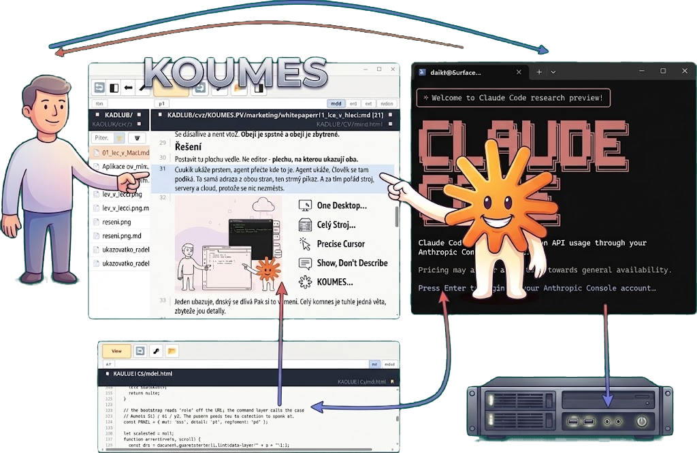

# KOUMES_PY - guide



Website: https://koumes.com

A shared workspace for a person and an AI agent. Both use the same things: what you click,
an agent can do by a command, and both see the same screen. It comes in two variants that do
not depend on each other, so use the one that fits.

| | Python variant | console variant |
|---|---|---|
| what it is | a desktop window, a browser for local files | panels in a terminal, on tmux |
| where | `KOUMES/`, `KOUMES_PY_APPS/` | `KOUMES_KONZOLE/`, `KOUMES_KONZOLE_APPS/` |
| shows | anything an html page can show | text, md, images, and any terminal program |
| needs | Python, PyQt6, PyQt6-WebEngine, websockets | Python, tmux |
| an agent talks to it | WebSocket, commands | `clmon` commands, tmux |

`cmd_sys/` is the command layer under both. `hg_pool_py/` and `hg_interactive_applib/` are
libraries for interactive Qt apps.

Install is a copy: copy the directory and run it from there. No pip, no package.

## Python variant

A browser that can open local files. Each panel shows a file through a viewer, a viewer is an
html page, and new ones are cheap to write.

```bash
python3 -m KOUMES                    # opens the directory you are standing in
python3 -m KOUMES /path/to/tree      # sandbox = that tree; the app cannot go higher
python3 -m KOUMES /tree /tree/subdir # ... and this subdirectory is the one to open
python3 -m KOUMES --headless         # no window, just commands and the WS bridge
```

**The sandbox is that first argument** and it is the only thing the app may change. A click
on `⬆` at its edge turns red - that is as far as it goes, until you extend the sandbox.

An agent talks to it over WebSocket: it sends a line with a command and gets a reply. The port
is `ws_port` in `other_config/config.t2l`, `--port` overrides it.

The guide is in **`other_manual/`**, chapters in order. It covers this variant.

## Console variant

```bash
KOUMES_KONZOLE/clmon                 # opens, or connects to the running one
```

A list of agents and numbered panels in one terminal window. **Besides its own apps a panel can
run ordinary software.** Everything sits in tmux, and that is what makes it work for two: any
terminal program, unchanged and without knowing about it, is used by a person at the keyboard
while an agent reads its screen and types into it.

```bash
clmon --tp1 --run 'htop'             # any program in panel p1
clmon --snapshot p1                  # what is on its screen, for the agent
tmux -L clmon4 send-keys -t PANE ... # keys for it, from the agent
```

So a program without any API still has two users. The guide is
`KOUMES_KONZOLE/KOUMES_KONZOLE.help.md` and `KOUMES_KONZOLE_APPS/KOUMES_KONZOLE_APPS.help.md`;
on the first start click [config] and assign what you want.

## When you want to reach into the code of the Python variant

Two modules stacked on top of each other, and the arrow only goes down:

```
KOUMES/     window, panels, viewers    - sends commands
   │
   ↓
cmd_sys/    commands, log, WS bridge   - knows nothing about the window
```

That is why the command layer can be run on its own (`--headless`) and a change
in a panel does not break it. Three rules that hold it together:

- **A module does not reach into another module.** `cmd_sys/` must not start
  importing Qt.
- **An action is done by a command, not directly.** A new button means a new
  command, not a new path into the panel. That is why an agent can repeat
  everything you click.
- **Panels do not talk to each other directly**, they meet on the bus
  (`panel_bus.py`).

What the app remembers between runs - the port, the window position, what was
open, the log of executed commands - lives in `other_config/`.

## Where next

- `KOUMES/KOUMES.help.md` - the window, the panels, where things are wired up
- `other_config/config.help.md` - the port and the window state
- `README.md` - the same thing in short
