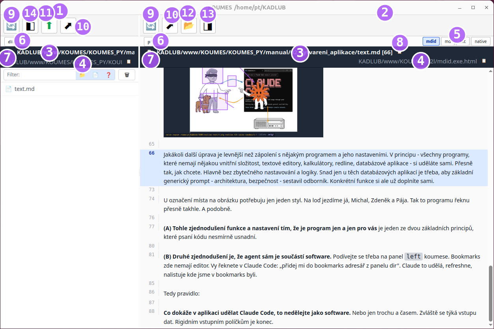
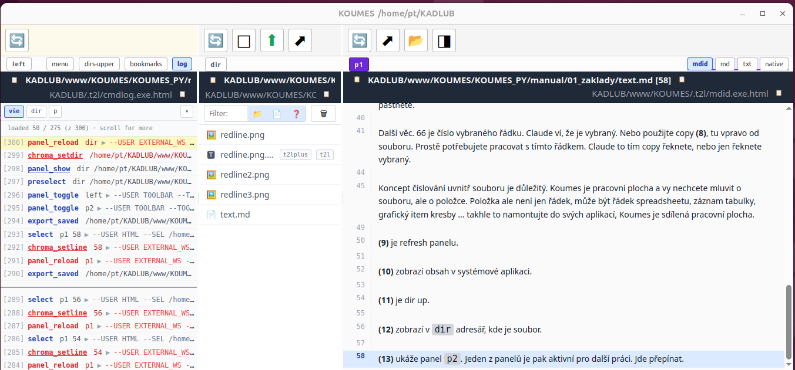

# 01_basics

Koumes is technically a browser that we've given the ability to open local
files. That way we get to use all of internet technology on your machine. In a
normal browser (Chrome, Edge) you can open a local file, but at the price of
security bullying. The web stays available: the `view` button on `p1` and `p2`
switches the panel between local files and a `www` tab.

## Panels and viewers



In the picture you see 2 separate panels - in a browser, tabs **(1)** **(2)**.
Each one displays some file **(3)** using some program **(4)**. In a browser
the program is always html. The file can be anything - html included.

**(5)** are the file's viewers. The active one is visible. But you can pick
any of them by purpose, or write yourself another one. One of them is called
`native` and it's the one already built into the browser - the shape you know
from browsing the internet.

## You share Koumes with Claude Code

**(6)** is the panel's name. And here is where Claude Code enters the game.
You can, of course, click a file in `dir` and it opens in `p1`, or a directory
that then opens in `dir`. That's half of the display. Above all you can tell
Claude Code:

```
TO CLAUDE ✻ open the manual directory in dir and chapter 1 in p1
```

If you let Claude Code sniff koumes at the start, it will do it - it gets in
through WebSocket at `ws://127.0.0.1:<port>`, the port is `ws_port` in
`other_config/config.t2l`. It runs the same commands you do.

**Koumes is not your application. It is a shared surface for you and Claude Code.**

Beyond setting the file and directory for you, it also knows where things are.
Just say something like `TO CLAUDE ✻ rename that file in p1`.

That can get tedious though - these icons **(7)** copy the name into the
clipboard and you just paste it into Claude.

One more thing. 66 is the number of the selected row. Claude knows it's
selected. Or use copy **(8)**, the one to the right of the file. You simply
need to work with that row. You tell Claude with that copy, or you just say
"the selected one".

The concept of numbering inside a file matters. Koumes is a workspace, and
you don't want to talk about the file, you want to talk about the item. An
item is not just a row - it can be a spreadsheet row, a table record, a
graphical item of a drawing... build it into your applications this way,
Koumes is a shared workspace.

## Toolbar

**(9)** is refresh of the panel.

**(10)** shows the content in a system application.

**(11)** is dir up.

**(12)** shows in `dir` the directory where the file is.

**(13)** shows the `p2` panel. One of the panels is then active for further
work. You can switch.

The `view` button, where it is shown, switches the panel between `view` and
`www`.

## The left panel



**(14)** opens the `left` panel. There again are some htmls that show
something - various info, html applications.

`log` You see it here, the whole essence of Koumes. Red lines were done by
Claude, the others by you.

`bookmarks` - bookmarks for dir. Ask Claude to add some.

`dirs-upper` - the directory one level above `dir`.

`menu` - a menu of the application, a Qt widget.
