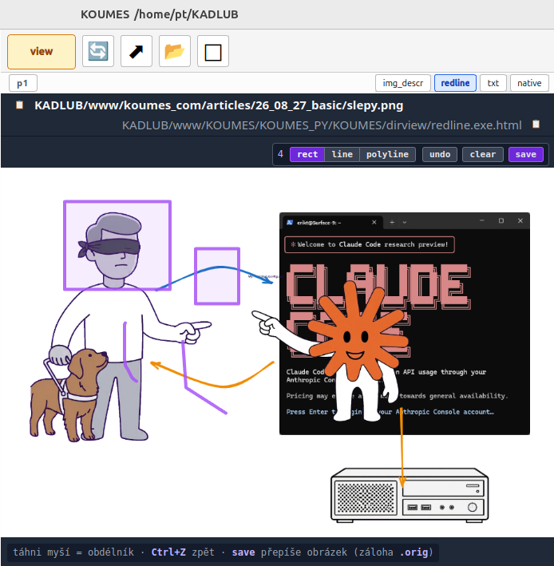
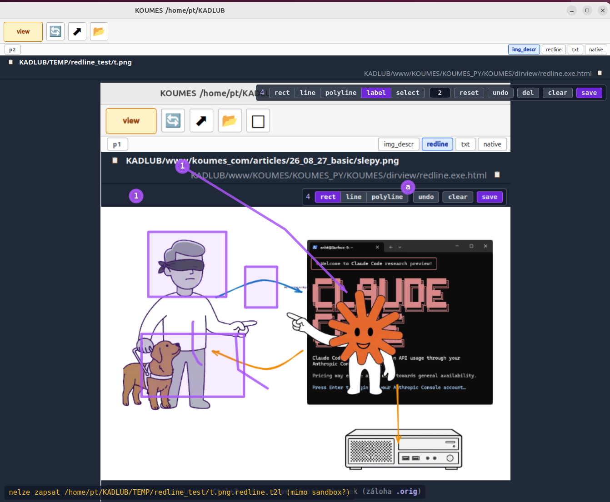
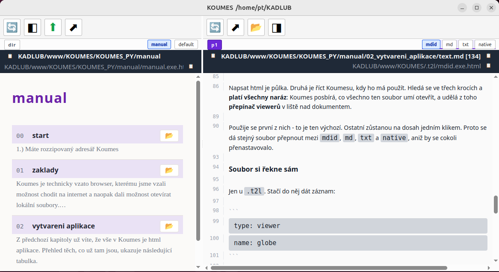

# 02_building_applications

## Introduction

From the previous chapter you already know that nearly everything in Koumes is
an html application. The table below is an overview of the ones that are
already there.

| panel | what it holds | application |
|---|---|---|
| `left` | dirs-upper | ⚡`KOUMES/KOUMES_PY/KOUMES_PY_APPS/dirs.exe.html` |
| `left` | bookmarks | ⚡`KOUMES/.t2l/bookmarks.exe.html` |
| `left` | log | ⚡`KOUMES/.t2l/cmdlog.exe.html` |
| `left` | menu | Qt widget, not html |
| `dir` | directories | ⚡`KOUMES/KOUMES_PY/KOUMES_PY_APPS/dirs.exe.html` |
| `p1` `p2` | `.md` | ⚡`KOUMES/.t2l/mdid.exe.html`, variant ⚡`KOUMES/.t2l/md.exe.html` |
| `p1` `p2` | `.png` | ⚡`KOUMES/.t2l/img_descr.exe.html`, variant ⚡`KOUMES/KOUMES_PY/KOUMES_PY_APPS/redline.exe.html` |

A viewer can also be a Python class instead of html: a `qt_viewer` line in
`other_config/config.t2l`. Html stays the rule, this is for what html can't do.

**The essence of working in Koumes is modifying these applications and creating
new ones. Claude will happily build them for you in a few minutes and Koumes
will run them.**

## How to build an application

I won't go far. To write this manual I needed to mark spots in the program -
that is, to add some graphics on top of a program screenshot. The classical
way is madly annoying - you tediously find a program, install it... and then
it doesn't do what you want.

We'll combine that with a redline program, which is where we'll start.

```
TO CLAUDE ✻ build me a program for annotating files; for png, jpg and other formats;
option to draw a rectangle, a freehand line and a polyline; drawing a polyline
ends on a left mouse click
```

Voilà.



That prompt is about as big as a search string would be into Google. And there
comes the taking, the searching, the reading, the installing, the configuring,
the fighting...

Here we wrote a short prompt and we have what we want, and we can fix it up
with another one.

But back to the annotations.

```
TO CLAUDE ✻ I want to annotate with numbers or letters, and I can pick the first
number/letter; if I don't hit reset after the first one, a line gets drawn
like a polyline with a full arrow at the end; I also need select/del
```

The result, or take a look at chapter 1 where I used it:



Any further tweak is cheaper than wrestling with some program and its
settings. In principle - every program that doesn't have some inner
complexity, text editors, calculators, redline, database applications - you
make yourself. Exactly the way you want them. Above all with no unnecessary
configuration and logic. Perhaps only for database applications you need
an expert to compose the basic generic prompt - architecture, security. The
specific functionality you then add yourself.

For marking a spot in an image I only need one style. So I tell the program
exactly that.

**(A) This simplification of function and setup by having the program be
just and only for you** is one of the two basic principles that make writing
code enormously easier.

**(B) The second simplification is that the agent itself is part of the
software.** Look for instance at koumes' `left` panel. Bookmarks have no
editor here. You tell Claude Code: "add the directory from the dir panel
to bookmarks". Claude does it, refreshes, and scrolls back to where we were
in bookmarks.

So the rule:

**Whatever Claude Code can do inside the application, don't build as software.**
Or only a little, and over time. This especially applies to data entry. The
end of rigid input fields.

## How is `...exe.html` looked up for your files?

Writing the html is half of it. The other half is telling Koumes when to use
it. The lookup runs in three steps and **all of them apply at once**: Koumes
collects everything that can open the file and builds a **viewer switcher**
into the toolbar above the document.

The first one is used - that's the default. The others stay one click away.
That's how the same file can be flipped between `mdid`, `md`, `txt` and
`native` without reconfiguring anything.



Top right above the text is `mdid` `md` `txt` `native` - everything that can
open that `.md`. Top left above the `dir` panel, the same for the directory:
`manual` or `default`.

### The file names it itself

Only for `.t2l`. It's enough to add a record inside it:

```
type: viewer
name: globe
```

From that moment on this file opens in `globe.exe.html`. It's first in order,
so it's the default - but viewers by extension are not cancelled by it, they
just fall in line behind. This is what a file like `nodes.t2l` uses
- node data that can be displayed as a globe.

### By extension in `config.t2l`

When a file doesn't name its own viewer, the extension decides. In
`.t2l/config.t2l` there are records:

```
type: viewer_ext
ext: md
viewer: mdid
```

So every `.md` opens in `mdid.exe.html`.

The lookup is **bottom-up** - first `.t2l/config.t2l` in the file's own
directory, then in parents, all the way to the root. All the ones found are
collected, in that order. The closer configuration is therefore first, and
so also the default - but the farther one stays in the switcher. That way
you can offer something extra inside one subtree without reaching into the
shared configuration.

## A directory can open itself as an application

When a directory holds a `.t2l` file **named the same as the directory** and
that file contains a `type: viewer` record, that viewer is offered for the
`dir` panel too. A switcher then appears in the toolbar between it and the
plain file listing.

This is how this manual is put together: `other_manual/other_manual.t2l` says
`name: manual` and `manual.exe.html` next to it renders the list of chapters.
