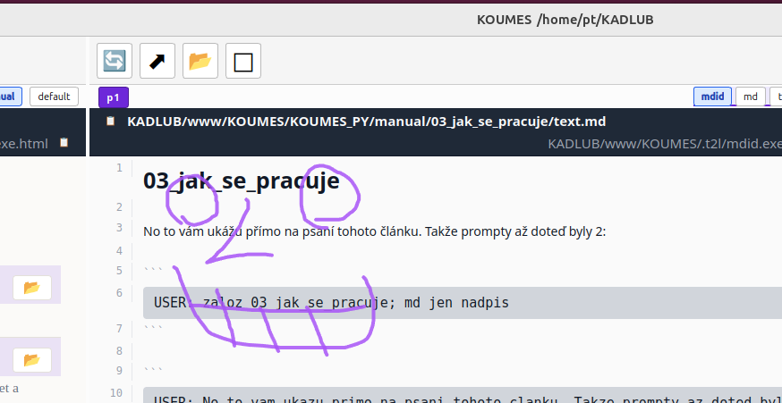
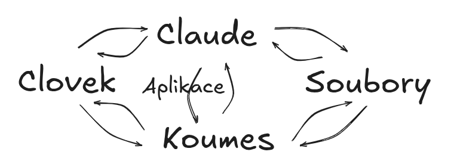

# 03_how_koumes_is_used

I'll show you that directly on writing this chapter. I write prompts into
Claude Code.

So the prompts up to this point were 2:

```
TO CLAUDE ✻ create 03 how_it_works; md just the heading
```

```
TO CLAUDE ✻ well I'll show you that directly on writing this article. I'll give
a few prompts as an example along with what was written and how. All of them
won't fit. We'd loop on ourselves (o:
```

It's simple, you just type a prompt into Claude Code. It does the rest, it
knows what 04 is and knows what to do with it. That's the similarity
principle - it knows what the other directories look like and where they
are. It just makes another similar piece.



```
TO CLAUDE ✻ we have an image in the clipboard; add it to the article, open it in
p2 too - put in the image and the prompt
```

I redlined the image in p2, as you can see.

Now I can, for instance, select an empty line and say what should go there.
But just a prompt with no action - that would already be chaos.

```
TO CLAUDE ✻ on the selected line in p1 add: some added text
```

And so on. From the Claude Code command line I give commands both to the
system and to Koumes. Sometimes I launch something in koumes, sometimes I
copy a filename over there, and so on. That's it. person - Claude Code -
Koumes - filesystem, roughly like that.



So hopefully you get it. Nothing other than Claude Code is needed, it does
everything. It does the work and the applications through which you can see
the work.
